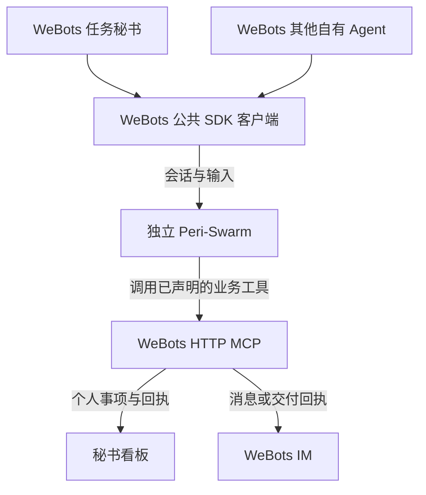
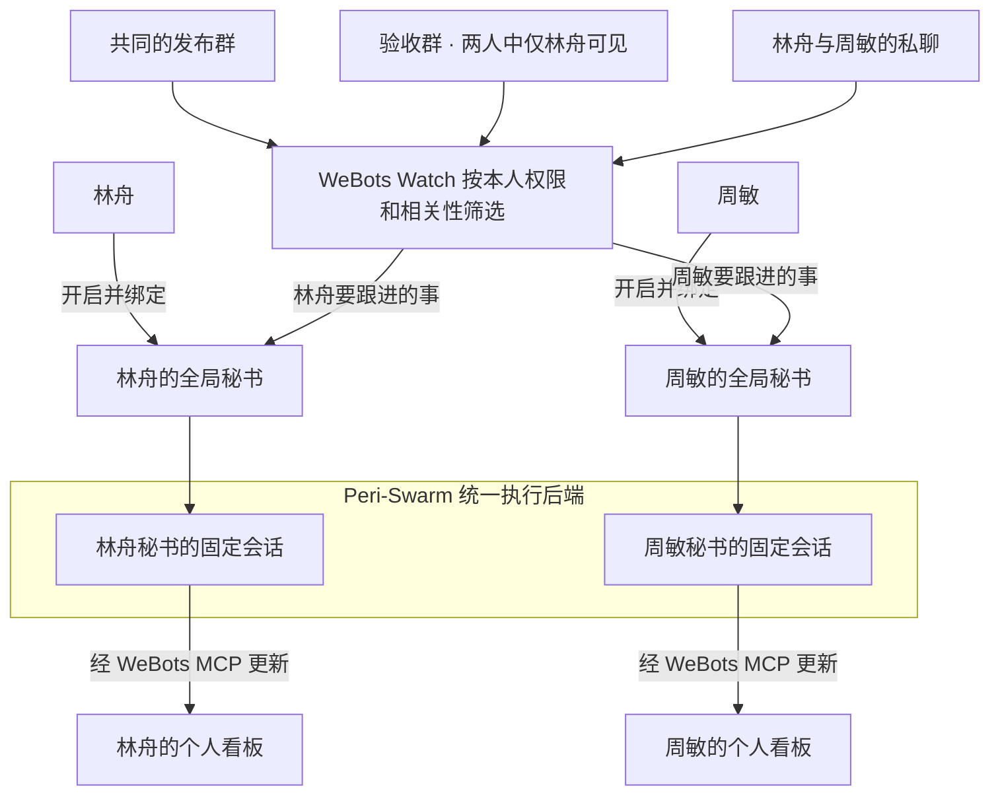

# WeBots v4.0 · Task Focus 个人 KanBan

**版本计划 · 2026 年 11 月 27 日。唯一发布里程碑为「个人 KanBan 切换完成」。**

**开工结论。** 产品范围、八个工作包和唯一发布里程碑已确定。分派顺序与先行验证见第 6.1 节。WeBots 仍需实现秘书、Watch、个人卡和看板浮窗。

**任务秘书是每个人在整个 WeBots 中的全局智能体。** 用户在会话列表左下角开启后，一位专属秘书使用同一个固定会话，跨本人有权访问的群聊和与不同人的私聊，维护一张个人看板。秘书从普通 IM 对话中找出与本人有关的承诺、请求和交付，自动建卡，收到实质进展时更新原卡。在当前聊天上方唤起个人看板大浮窗，就能看清轮到我做什么、我在等谁，并一键跳到原消息。用户随时可以归档，决定停止跟进。

| 发布决定 | 验收口径 |
| --- | --- |
| 个人 KanBan 全面接替现有 Task | 删除两代旧 Task 的运行机制与专属数据。旧卡迁入数、兼容读写入口数、残留数据数均为零。 |
| 一位用户、一名全局秘书、一个固定会话、一张个人看板 | 同一 Human 换群、换设备、暂停再启或服务重启，均接续同一秘书会话。两人关心同一件事，有两个独立的事项 ID、下一步和归档决定。 |
| 秘书主动整理 | 用户只需开启、查看、查源和归档。新建、更新、跨会话关联、换列均由秘书完成。已结束仍展示，直到本人归档。 |
| Agent 后端 | 所有 WeBots 自有 Agent 共用独立部署的 Peri-Swarm。WeBots 定义每个角色的身份、指令、触发条件、可用工具和交付方式。Task Focus 在 WeBots 定义秘书角色，每位开启用户各自绑定一名全局秘书。 |
| 本次交付 | 本文是可分派的发布计划。配套 HTML 使用虚构 IM 事件演示交互。生产代码、线上数据和实际发布均留给后续实施。 |

## 1 · 先看一轮灰度发布

林舟负责放行，周敏负责交包和通知值班。两人同在版本发布群，也可以彼此私聊。只有林舟加入灰度验收群。以下均为切换后发出的普通消息。

| 消息或动作 | 林舟的秘书 | 周敏的秘书 |
| --- | --- | --- |
| 09:00，林舟在版本发布群说「回归和安装包齐了，由我拍板。周敏交包，我确认后请你通知值班。」 | 建「确认 RC2 灰度放行」，进入**跟进中**，等两份交付 | 建「交付 RC2 并通知值班」，进入**需要我**，先交包 |
| 09:12，回归 Agent 在灰度验收群引用该委托，报告 32/32 通过 | 更新原卡，记下回归结果，继续等包 | 原卡保持原样。看板、计数、筛选、来源和提示均不透露验收群及其结果 |
| 09:18，周敏私聊林舟交付同一 RC2 包 | 原卡进入**需要我**，下一步是决定是否放行。详情可回到两个群和这段私聊的三条不同原消息 | 原卡转为**跟进中**，等待林舟决定。能引用发布群与本人私聊 |
| 09:24，林舟在版本发布群确认放行，要求周敏通知值班 | 自己承诺的决定已作出，进入**已结束**。此时仍可查看或接收更正，林舟可点归档 | 原卡进入**需要我**，下一步是通知值班 |
| 09:27，周敏确认值班同事已收悉。09:31，构建 Agent 补发相同的包 | 若已归档，记录冻结。若仍跟踪，可增加新的签收证据，补发同一份包无实质变化 | 周敏的卡进入**已结束**，等待本人归档 |
| 09:36，阿宁在同一讨论中请林舟明早交一页灰度复盘 | 自动新建「整理本轮灰度复盘」。旧放行卡仍归档。相同话题中存在另一个交付目标 | 这项委托没有给周敏增加责任，原卡保持原状 |

只开林舟一人的秘书，也能跑完林舟的链路。同事和普通 Agent 照常使用 IM，无需开启自己的秘书、进同一个新群或手动给消息加标记。

## 2 · 一张个人卡的生命周期

| 栏目或状态 | 进入条件 | 卡面说清什么 |
| --- | --- | --- |
| **需要我** | 有证据表明本人要交付、答复、决定、验收或解除阻塞 | 可执行的下一步、等我的是谁、明确的期限 |
| **跟进中** | 本人关心结果，当前由他人推进或尚有依赖 | 在等谁、等哪个交付物、最新能确认的进展 |
| **已结束** | 本人承诺的范围已经完成或明确取消，当前没有本人动作 | 完成或取消的依据。后续有效更正可让原卡回到前两列 |
| **已归档** | 本人在任一列点归档 | 从三列移出，保留本人可读的冻结记录。取消后续跟进，迟到、重试、改标题或重复发包均不能复建 |

**建卡门槛。** 同时具备可定位的工作事项，以及本人需要关注的理由。对本人有明确委托、本人承诺了某件事、本人在等交付、现有事项的前置条件发生变化，都能成立。「群里在讨论灰度」或「某人管理这个 Agent」本身不能成立。闲聊、泛播和无实质变化的回执不占看板。

**关联与责任交接。** 先找可见的消息回复链、原委托引用、交付对应的原消息，必要时组合版本、交付物、稳定人员身份和明确的交接约定。能唯一定位才更新同一张卡。两个候选同名、两个群分别做 RC2 时，暂存待判断的来源，等后续澄清。换执行人时分别记录「已请接手」和「已确认接手」的出处。多个 Agent 并行时分别记交付物；单个 Agent 完成投递，只推进它负责的部分。需要本人确认的工作继续留在「需要我」。

**事实与时间。** 每个下一步、期限、阻塞和完成结论都有当前可见证据。明确日期使用用户时区，保留原话；未给期限就留空，进度优先写「两份交付中已收一份」。有冲突时保留来源和最后一次能确认的事实。仅时间流逝可标「已过约定时间」，不能推断工作已完成。

## 3 · 聊天上方的大浮窗与快速跳转

从版本发布群打开「我的看板」，浮窗覆盖在这段聊天上方。直接收起时，仍在原来的消息位置，可以继续写刚才的草稿。点某张卡的「原消息」才会切换会话。这样，在群里工作的人可以随时看一眼全局，也能从全局直接回到需要答复的那句话。

| 用户动作 | 浮窗与聊天的行为 |
| --- | --- |
| **开启或唤起** | 会话列表左下角首次显示「开启任务秘书」。首次点击即打开看板，以后同一位置显示「我的看板」和本人待处理数。在任意群、本人私聊都唤起同一个浮窗。秘书是否运行由账号开关决定，收起浮窗只影响当前设备上的显示。 |
| **浏览个人总览** | 桌面居中，默认宽约为视口的 90%，高约为可用工作区的 88%，上限 1480 × 960 像素。背景保留当前 IM 的可辨轮廓。窗口内并排展示「需要我／跟进中／已结束」。手机使用近全屏浮层，留出边距，三个栏目点按切换。标题区固定，内容区独立滚动。 |
| **从卡片直达聊天** | 每张卡的底部都是独立可点的「原消息」。平时直达最近一条可见依据；已按来源会话筛选时，直达该会话最近一条依据。一次点击即可收起浮窗、进入正确的群或私聊、滚至对应消息并高亮。卡片标题另行打开事项详情，可以选更早的依据。 |
| **查找事项或原话** | 点右上角「快速跳转」，或按 Mac 的 **⌘K**、Windows／Linux 的 **Ctrl+K**。可搜事项标题、人名、群名、私聊或原话片段。结果分为「事项」与「原消息」两种，分别打开卡片详情或直接定位聊天。方向键选择、Enter 打开、Esc 返回。已开启秘书时，也能从聊天区用快捷键唤起；正在输入聊天草稿或中文组词时尊重编辑器。 |
| **一键回到断点** | 在目标聊天点「返回看板」。从卡片出发回原卡，从详情出发回同一条进展，从搜索出发恢复搜索词和选中的结果。保留当前／已归档、来源筛选、手机栏目与滚动位置。途中有新进展，按稳定事项 ID 恢复；已换列的事项在手机上跟随新列，已不可见的目标回退到仍可访问的总览。 |
| **查看或收起** | 宽桌面在浮窗内并排打开详情，小屏在同一浮窗中阅读详情。Esc 依次收起搜索、详情、看板。右上角关闭键或点击窗口外可一次收起整窗。当前会话、草稿和秘书工作不受影响。个人归档仍在详情中完成，归档后的卡可在「已归档」回看。 |

**查找范围。** 「当前事项」下搜索本人的在跟事项及可读的原消息；「已归档」下搜索本人的归档记录及仍可读的依据。快速跳转覆盖所在页的所有栏目和会话，结果同时给出会话、发言人或摘要以区分同名对象。打开另一张事项时，如果现有来源筛选与目标冲突，解除该筛选并定位目标。输入词、选中项和返回位置都属于当前用户的当前窗口，切换账号清空。

**原消息定位。** 快速跳转复用 Human 聊天页已有的 `network_history_list(anchor_message_id)`。后端校验房间、消息和本人历史边界，前端已有 `openAnchor` 加载目标附近的时间线。看板切到目标房间并挂载正确会话后调用该入口，再滚到原文。连续点选以最后一次有效跳转为准。返回时恢复原卡、搜索词、选中项和位置。来源撤回或已失权时，在卡主当前范围内给出可返回的状态。[已有的锚点读取](https://github.com/KonghaYao/agent-network/blob/1b8ccc652b6760adc5a9142abb1162fbca209938/src/web/hooks/useMessageSearchNavigation.ts#L133-L164) · [后端校验](https://github.com/KonghaYao/agent-network/blob/1b8ccc652b6760adc5a9142abb1162fbca209938/src/domain/timeline.ts#L339-L347) · [虚拟列表定位](https://github.com/KonghaYao/agent-network/blob/1b8ccc652b6760adc5a9142abb1162fbca209938/src/web/features/chat/TimelineVirtual.tsx#L223)

**在 HTML 中体验。** 以林舟身份在版本发布群写几个字的草稿，再点左下角开启秘书。用演示底栏推进到 09:18，点「确认 RC2 灰度放行」卡片底部的「原消息」，会直接到周敏交包的私聊。点「返回看板」，再用「快速跳转」搜「32/32」，可跳到验收群的原话。切换到周敏并开启她的秘书，用同一个词会得到空结果。文件可离线打开，底栏的身份、播放与重置仅用于演示。

## 4 · 统一 Agent 后端与 WeBots 秘书的职责

11 月 27 日核对了 WeBots `main@1b8ccc65`。可复用的入口包括事务内写入的房间和 inbox 事件、SQLite outbox、按成员代次计算的历史边界、按接收者投递和 HTTP MCP。个人秘书绑定、Watch 作业、个人卡及专用 MCP 工具均是本里程碑的实施项。普通工作 Agent 继续按既有的定向投递与个人历史窗口工作。[WeBots 基线](https://github.com/KonghaYao/agent-network/tree/1b8ccc652b6760adc5a9142abb1162fbca209938) · [房间历史边界](https://github.com/KonghaYao/agent-network/blob/1b8ccc652b6760adc5a9142abb1162fbca209938/src/domain/room-history.ts#L36) · [事件分发](https://github.com/KonghaYao/agent-network/blob/1b8ccc652b6760adc5a9142abb1162fbca209938/src/realtime/outbox.ts#L62) · [现有 MCP 入口](https://github.com/KonghaYao/agent-network/blob/1b8ccc652b6760adc5a9142abb1162fbca209938/src/app.ts#L728)

| 环节 | 实施契约 |
| --- | --- |
| 启用与身份 | 以当前实例内 Human 的稳定 actor ID 唯一绑定一名秘书 Agent 与一个终身 session。首次启用原子保留绑定，再按 4.2 节幂等开通远端会话。账号关闭网页后后台仍运行。未开启账号零秘书作业、零模型调用、零卡。权限只能由服务端根据本人身份签发。 |
| 切换与首轮读取 | 切换时记录持久事件水位 **C**。首次开启记录当前水位 **H**，只在 `C < event_seq ≤ H` 且最近 7 天的区间内，分页审视本人可见的普通工作消息和原生 delivery 变化；实时从 H 后接续。新安装将空库起点视为 C。新卡必须有切换后证据，旧 Task 数据从不导入。 |
| 增量与成本 | 服务端从已提交的业务事件中识别候选人。显式委托、承诺或已关注事项优先；无 @ 的普通消息结合活跃会话短上下文判断。按个人和话题合并密集回执，建议静默 5 秒、最长 30 秒。outbox 唤醒，持久游标补漏，采集游标与实际作业完成分开记录。 |
| 读取权限 | 入队、供模型读取、提交、界面读取分别检查 owner、成员代次、历史上下界、撤回和 delivery 详情权限。私聊限当事人。退出群或来源失效时，先遮蔽依赖该证据的正文、标题、来源计数、通知、搜索和归档字段，再用余下合法证据重算；无合法证据则隐藏整卡。 |
| 秘书判断 | 输入仅有本账号身份、合规来源和少量相关个人卡。输出为新建、更新、忽略或待判断，并给出目标、可核验的理由与逐字段证据。允许跨群归并，严禁跨 owner 读卡或借用对方的隐私证据。只有秘书可写业务内容；聊天正文不能授予权限或驱动对外发言。 |
| 写入与竞态 | 每条实质变更校验 owner、启用代次、作业租约、来源修订、卡片版本与归档屏障。个人卡、引用、修订与作业确认同事务写入。重放按业务来源与修订去重；较旧报告不能覆盖新事实，显式纠正保留出处。碰到归档先停止，遇版本冲突重读。 |
| 暂停与恢复 | 暂停时提升代次，停止采集、到期检查和进行中的提交；已有卡与归档记录保留。重开复用原秘书，以新水位接后续委托。可为已跟踪且未归档的事项核对停用期间的进展，期间新出现的独立委托不补建。 |
| 刷新与故障 | 分发变更提示只给卡主，不计群未读、不改 delivery。客户端按个人版本增量拉取，过期则刷新快照。临时模型故障时保留上次事实、重试并展示「暂缓更新」；积压可恢复。账号切换清空旧视图，正式 PWA 不持久缓存私有正文。 |

**数据和接口。** 秘书绑定、个人卡、证据、修订、归档定位和队列属于 WeBots。个人卡主键独立于消息 ID。每条证据携 owner、原始业务 ID、来源修订和用途；普通线程可承载多个独立委托。归档事务保留足够识别同一工作的定位；新的交付目标与请求消息可开新卡。看板不依赖 Memory 召回或第三方观测服务。

| 调用方 | 本版拟定的入口 | 允许的操作 |
| --- | --- | --- |
| 本人，网页或 Human MCP | `network_focus_status / network_focus_enable / network_focus_disable` | 查看或改变本账号的开启状态。owner 从身份推导，并发幂等。 |
| 本人，网页或 Human MCP | `network_focus_list / network_focus_get / network_focus_archive` | 分列、筛选、分页、查证据、归档。写入归档时校验 owner，重复请求返回同一次归档。 |
| 专属秘书 Agent | 第 4.3 节的四个 HTTP MCP 工具 | 能力绑定本人、秘书、作业、租约和启用代次。秘书读取受托范围的证据、提交个人事项判断。归档由卡主发起。 |
| WeBots 的 Watch 工作进程 | 第 4.1 节的公共 SDK 客户端 | 作业分配、重试和业务回执由 Watch 管理。公共客户端负责打开会话、发送输入和读取运行状态。 |

### 4.1 · 所有自有 Agent 共用 Peri-Swarm

**Peri-Swarm 是 WeBots 自有 Agent 的统一执行后端。** WeBots 决定一个 Agent 是谁、为何被唤醒、能读写什么、怎样算完成。Peri-Swarm 接收 WeBots 给出的模型、指令、工具声明和输入，运行 Agent 并维护会话。Task Focus 在 WeBots 定义秘书角色、提示词和 Watch 策略，秘书的模型推理与工具调用在 Peri-Swarm 内执行。群内交付等其他自有角色复用同一套后端，按各自的规则选择会话、工具与结果去向。

**底层能力与对接责任**

| 能力 | Peri-Swarm 的通用契约 | WeBots 实现和验收 |
| --- | --- | --- |
| 角色配置与推理 | 接收 `agent.model`、`agent.instructions`、`agent.tools` 和 `environment`，在配置好的 provider 上运行模型。 | 平台维护角色指令版本、模型选择和 MCP 工具声明。秘书配置采用 `environment.type=none`。测试时给两个角色不同指令与工具，用同一 Swarm 镜像分别运行。 |
| 创建、寻址、恢复会话 | `sessions.create/retrieve` 提供逻辑会话 ID 和 Peri 根 ID。同一创建键支持重复开通，持久历史可按原根加载。 | 平台保存 WeBots Agent 与远端会话的映射。会话归属由角色决定。秘书在本实例内按 Human 唯一绑定；普通角色沿用自身的会话规则。重启后核对两个 ID 及获准的前情。 |
| 接收输入、执行与取消 | `sessions.events.create` 接收一条输入消息或取消事件，返回受理收据。相同投递键和相同内容可重试。`turns.retrieve` 提供持久轮次状态。 | 公共客户端传递稳定投递键。上层发起者决定何时重试、取消以及如何结算业务。秘书按个人作业串行派发，普通群 Agent 按获派的 delivery 工作。 |
| 事件、回放与对账 | `events.stream` 提供实时事件，`items.list` 和 `turns.list/retrieve` 提供历史。Swarm 支持续读持久 item 序号。 | 公共客户端处理断线、分页和终态查询，向调用方返回运行结果。秘书拿这个结果与 WeBots 的卡片提交回执核对，普通 Agent 可用它核对自己的交付。 |
| 调用外部工具 | 会话可声明 HTTP MCP，Swarm 作为 MCP 客户端发现并调用工具，向模型返回工具结果。 | WeBots 提供业务工具、身份和逐次授权。秘书暴露第 4.3 节的四个 Focus 工具；群内工作 Agent 领取和完成获派的交付。工具发现和直接调用都在 WeBots 服务端核权。 |
| 调度、持久化与部署 | 独立 Compose 由 nginx 提供 `/v1` 入口，默认两个网关副本，共用 Rivet 和 PostgreSQL。`peri_session` 保存 Peri 会话历史，`peri_swarm_state` 保存运行绑定、turn、items 和输入收据。 | WeBots 后端通过 SDK 访问网关，SQLite 保存 WeBots 角色业务状态和远端 ID。秘书卡片及其证据以 WeBots 的记录为准。两服务可独立重启。跨主机使用双方可达的私网地址，两个 Swarm 副本都要实测回调成功。 |
| 已撤权证据的上下文过滤（待联调） | 固定根会话下一次组装模型请求时，需要排除已失效来源及其派生内容，涵盖历史工具结果、回复和压缩摘要。已合入主线的 Agents API 未提供按 WeBots 来源撤回模型历史的公开操作。 | WeBots 掌握业务权限，为交给模型的证据关联来源、修订和当前有效性。运行时团队验证通用过滤能力，必要时补齐。用同根退群、重启与压缩样本核查，详见第 4.4 节。 |

2026 年 11 月 27 日 16:30（北京时间），#614 已合入 `main`，合并提交为 `b9fd1a29`。#606 的 PostgreSQL 迁移也已合入。开工锁定已核对的 Peri 主线 `b2dcabfa`、WeBots 主线 `1b8ccc65`、官方 `openai@7.60.0`。联调记录须包含实际部署镜像摘要、两端 SHA 和 SDK 锁版。`/healthz` 可确认网关进程存活，模型与 MCP 回调就绪由真实角色运行证明。[Agents API 合并记录](https://github.com/KonghaYao/peri/pull/614) · [PG 合并记录](https://github.com/KonghaYao/peri/pull/606) · [SDK 兼容范围](https://github.com/KonghaYao/peri/blob/b2dcabfaec6b1a9cdd6fcb62880fe9d5ca46f4db/peri-swarm/README.md#L318) · [Compose 部署](https://github.com/KonghaYao/peri/blob/b2dcabfaec6b1a9cdd6fcb62880fe9d5ca46f4db/deploy/README.md)

**WeBots 的公共 SDK 客户端。** 在现有 Bun 后端封装官方 `openai@7.60.0` 的 `client.beta.agents.sessions`。提供下列本地调用。接口参数使用角色配置、会话与通用输入，返回远端身份、投递收据、事件或 turn 状态。调用方用自己的业务主键关联这些结果。

| 本地调用（拟定） | SDK 操作与返回值 |
| --- | --- |
| `ensureSession(profile, binding)` | 待开通时带首次创建键调用 `sessions.create`。已绑定时调用 `sessions.retrieve`。返回经核对的 `session.id`、`rootSessionId` 或可诊断的错误。 |
| `submitInput(session, input, key)` | 通过 `sessions.events.create` 发送不可变输入与幂等键。使用 `.asResponse()` 读取 202 和 Swarm 收据。同键异文的 409 交给发起者核查。 |
| `observe(session, checkpoint)` | 派发前建立 `events.stream`。断开后从已消费的持久序号续读，按需查询 `items` 和 `turns`，返回运行事件、持久终态及新游标。 |
| `cancelActive(session, key)` | 用独立取消键发 `agent.session.input.cancel`，返回受理回执。调用方在持有该会话的调度权并核对当前轮次后发起，最终结果从持久 turn 确认。 |

建议将 `WEBOTS_SWARM_BASE_URL` 和 `WEBOTS_SWARM_API_KEY` 配在 WeBots 后端，分别指向独立 Swarm 的 `/v1` 和部署凭据。各角色在自己的工具声明中提供 Swarm 可达的 MCP URL。provider 密钥在 Swarm 部署中管理。平台部署与 SDK 的连接配置可供所有角色复用。[官方 SDK 会话指南](https://developers.openai.com/api/docs/guides/agents-api/sessions) · [Peri-Swarm SDK 调用示例](https://github.com/KonghaYao/peri/blob/b2dcabfaec6b1a9cdd6fcb62880fe9d5ca46f4db/peri-swarm/README.md#L357)

### 4.2 · 每个人的全局秘书与固定会话

秘书归属于 Human。群聊、私聊和交付记录提供这位 Human 有权使用的证据。一个人换群、换私聊对象或换设备，原秘书都会接着跟进。两个人即使参与同一件事，也各有自己的秘书、固定会话和看板。

周敏在私聊里交包后，林舟的下一步是「确认是否放行」，周敏的下一步是「等林舟确认」。验收群的 32/32 回归报告只对林舟可见，只有林舟的秘书可用它作为依据。林舟归档自己的卡后，周敏的秘书继续按周敏的职责跟进。

| 标识 | 权威来源 | 用法 |
| --- | --- | --- |
| `owner_actor_id`、`secretary_actor_id` | WeBots | 「一个 Human 一位秘书，一个固定会话」是 Task Focus 的产品规则。每个实例内按 Human 唯一约束。先在本地预留绑定，拿到远端根 ID 后，由 WeBots 用它登记秘书的 `agent_session_id` 并激活 Watch。 |
| `provisioning_key` | WeBots | 首开事务生成随机稳定键并保存本次创建配置。调用 `sessions.create` 时通过请求选项设置 `Idempotency-Key` 头，省略 `logicalId` 和初始 `input`。同键、同配置重试，Swarm 会派生同一个逻辑会话。两端同时开启或创建响应丢失都沿用这行记录。 |
| `session.id` 和 `rootSessionId` | Peri-Swarm | 前者就是 Swarm 的逻辑路由 ID，用于后续 SDK 调用；后者是持久 Peri 根 ID，由适配器从 Swarm 响应的扩展字段读取并校验。首次成功后写回绑定。激活后只认这两个已存值。 |
| `job_id`、`attempt_ref`、`submission_key`、`turn_id` | 前三者由 WeBots 创建，turn 由 Swarm 创建 | 一个作业可有多次受控尝试。每次尝试先落库其不可变请求和投递键，同次网络重试使用原值。收到 turn 事件后关联 `turn_id`，202 收据的 `inputId` 单独保存。个人事项另有跨轮稳定的卡 ID。 |

创建使用 `environment.type=none`、部署支持的模型和秘书提示词。`agent.tools` 只声明一个 `type=mcp` 服务，`server_label` 可用 `webots_focus`，`transport` 使用官方的 `type=http` 和 `server_url`。URL 是两个 Swarm 副本都能访问的受信 WeBots 入口。账号切群、换人私聊、换设备、暂停再开或服务重启，都按已存 ID 调用 `sessions.retrieve`。活跃绑定出现 404、原根不符或持久历史无法载入，显示「等待恢复」并保留作业。恢复时核验同一根上的已授权前情。[开通键的代码契约](https://github.com/KonghaYao/peri/blob/b2dcabfaec6b1a9cdd6fcb62880fe9d5ca46f4db/peri-swarm/src/http/request.rs#L318) · [Swarm 会话身份字段](https://github.com/KonghaYao/peri/blob/b2dcabfaec6b1a9cdd6fcb62880fe9d5ca46f4db/peri-swarm/src/domain/session.rs#L329) · [WeBots 身份登记](https://github.com/KonghaYao/agent-network/blob/1b8ccc652b6760adc5a9142abb1162fbca209938/src/domain/identity.ts#L110)

### 4.3 · Watch 如何派单，秘书如何更新看板

**Watch 先回答「这件变化跟谁有关」。** 从已提交的房间消息、本人私聊、原生回复引用和逐接收者交付状态中找候选人，包括本人主动许下的承诺，以及没有 @ 但有明确指向的请求。成员、历史权限、撤回和归档优先失效处理。复用房间事件、outbox 唤醒与历史边界，扫描游标和处理回执分别落库。按已有事项、交付引用和 owner 合批，按人轮转调度。无需为每个群开一条 Swarm 流。事件已超过保留水位时，从现存可读消息和交付分页补查；无法重建的区间记录缺口，保留最近有证据的卡状态。[消息与事件原子写入](https://github.com/KonghaYao/agent-network/blob/1b8ccc652b6760adc5a9142abb1162fbca209938/src/domain/messages/view.ts#L263) · [事件保留与水位](https://github.com/KonghaYao/agent-network/blob/1b8ccc652b6760adc5a9142abb1162fbca209938/src/maintenance.ts#L202)

**秘书怎样使用公共客户端。** Watch 先持久化 `job_id`、本次尝试、不可变输入和投递键，在原秘书会话上先 `observe` 再 `submitInput`。同一批候选放入一条 `agent.session.input.message`，只交作业引用和本次授权引用。202 推进到「已受理」。秘书通过下表的 MCP 工具取证并提交。只有 WeBots 收到这批决定的持久业务回执，才推进作业完成水位、通知个人浮窗。

断流后，公共客户端取回原会话运行事实，Watch 对账未结项。暂停时 WeBots 先收回旧尝试写卡的权限，再视当前轮次调用 `cancelActive`。空闲会话可以停止订阅，在下一批开始前续订。`rootSessionId`、202 的详细收据、按持久 item 序号续读和原始页的 `nextCursor` 统一由公共客户端解析。[Peri-Swarm 事件语义](https://github.com/KonghaYao/peri/blob/b2dcabfaec6b1a9cdd6fcb62880fe9d5ca46f4db/peri-swarm/README.md#L431)

| 秘书专用 MCP 工具（拟新增） | 输入 | WeBots 保证的结果 |
| --- | --- | --- |
| `network_focus_job_get` | 当前作业和尝试引用 | 提供本人候选事件索引、变化理由、待决项与可读范围。 |
| `network_focus_evidence_read` | 同一尝试、候选消息或交付引用、分页 | 按当前成员代次和撤回状态给出有限原文、来源修订及原消息定位。 |
| `network_focus_items_find` | 同一尝试、来源或工作对象 | 只在本人事项中查重和识别归档。证据能唯一定位时，跨群、私聊可合并到同一张卡。 |
| `network_focus_commit` | 同一尝试、稳定决定 ID、预期卡版本、各结论的证据修订 | 同一事务记录新建、更新、忽略或待澄清及回执。只对实质变化发布本人的看板更新。 |

周敏在私聊交包时，林舟的秘书用自己能看到的验收群回执和交包消息，把原卡移到「需要我」，下一步写「确认灰度放行」。周敏的秘书只能给她自己的卡写「等待林舟确认」。浮窗只读 WeBots 卡片快照与个人变更通知，点来源回到各自有权读的原消息。用户点击归档后，同一件事的迟到消息和作业重放都不能让这张卡复活。

#### 4.3.1 · Watch 中心、群消息与领取日志

**每套 WeBots 设置一个逻辑上的 Watch 中心。** 用户在左下角开启秘书后，中心就从第 4 节约定的事件水位观察本人可读的群聊和私聊。用户和工作 Agent 都可以尚未在群里发过言。中心共用一份增量事件读取进度，只为与开启用户有关的事项安排秘书作业。每位用户始终使用自己的固定秘书会话。工作 Agent 按原有方式领取定向投递，其默认 monitor 输出投递、提醒和需处理的回执，显式配置 `--room-events` 才会输出普通群事件。群里发过言不会改变这项配置。[客户端监听范围](https://github.com/KonghaYao/agent-network/blob/1b8ccc652b6760adc5a9142abb1162fbca209938/client/commands/monitor.ts#L410-L420)

| 中心要回答的问题 | 权威事实与处理 |
| --- | --- |
| 这份工作派给了谁？ | 从房间 `message_created` 的原消息 ID 找同一事务创建的 `deliveries`。每名接收 Agent 一条，初始为 `pending`。群内显式 `invoke` 可以不写文字 @。只说「收到」或「我来做」可作为聊天承诺，原生交付状态以服务端记录为准。[派发对象](https://github.com/KonghaYao/agent-network/blob/1b8ccc652b6760adc5a9142abb1162fbca209938/src/domain/messages/send.ts#L73-L78) · [创建逐人投递](https://github.com/KonghaYao/agent-network/blob/1b8ccc652b6760adc5a9142abb1162fbca209938/src/domain/messages/view.ts#L314-L331) |
| 哪位 Agent 在何时正式领取？ | `network_delivery_claim` 调用 `deliveryClaim()`。成功事务将该条投递从 `pending` 改为 `claimed`，并写房间和 inbox 两份 `delivery_claimed`。中心取房间那份，用 `event_seq` 去重，以 `delivery_id`、`recipient_id` 和原消息定位。Agent 即使没有发确认消息，领取依然可见。失败或冲突不会写成功领取记录。[领取事务](https://github.com/KonghaYao/agent-network/blob/1b8ccc652b6760adc5a9142abb1162fbca209938/src/domain/deliveries.ts#L413-L455) |
| 后续没 @ 的话，跟哪张卡有关？ | 对未归档事项，先用交付 ID、结果消息或直接回复的原消息定位。只有普通正文时，用卡主可读的短上下文核对具体工作对象和责任人。回复同一线程或同一 Agent 发言只能缩小范围。候选仍有多项时记「待判断」，无关消息只计数。确认属于原事项的改期、交包或取消进入原秘书会话。单凭这一次匹配不会向工作 Agent 派发新交付。[消息引用字段](https://github.com/KonghaYao/agent-network/blob/1b8ccc652b6760adc5a9142abb1162fbca209938/src/domain/messages/view.ts#L286-L307) |

**接入时机。** 在 `drainOutbox()` 取得已提交的房间事件后、`fanoutStreamItems()` 分发前，给 Watch 中心一个异步唤醒信号。中心按持久 `event_seq` 顺序读取，候选作业、相应日志和采集游标在同一事务写入。进程启动与现有分钟调度负责补扫。看板归档立即停止该用户对这件事的后续跟进。用户退群、来源撤回或权限改变时，按第 4.4 节重新核定证据和日志的可见范围。[outbox 接入点](https://github.com/KonghaYao/agent-network/blob/1b8ccc652b6760adc5a9142abb1162fbca209938/src/realtime/outbox.ts#L73-L108) · [启动与定时调度](https://github.com/KonghaYao/agent-network/blob/1b8ccc652b6760adc5a9142abb1162fbca209938/src/bun/main.ts#L482-L487)

**跟进日志须能回答「谁领了」和「为什么我的卡变了」。** 日志放在 WeBots。保留来源事件的发生时间和中心的处理时间，分别用于显示业务顺序和诊断积压。

| 记录 | 最少保留的内容 | 怎样查 |
| --- | --- | --- |
| IM 来源 | 版本切换后，在既有领取事务中用同次房间回执的 `event_seq` 唯一登记一条领取流水，保存房间、原消息、交付、执行 Agent、当次 `attempt` 和领取时间。即使当时没有个人卡或 Watch 后台暂停，成功领取仍有迹可查。现有房间领取事件未带轮次，切换前的历史有当时证据才展示轮次。 | 按有权查看的群、工作 Agent、交付和时间查。一次领取只有一条业务记录，重放沿用同一来源。 |
| 个人关联与作业 | 对进入判断的候选记卡主、来源事件、关联依据、处理结果及可用的 `job_id`、卡 ID。区分已入队、合并、待判断、忽略、已归档。无关高频消息按批记扫描区间和计数，避免为每名群成员复制一行。 | 卡详情可查本人的跟进记录。按交付可串起原消息、领取回执及本人受影响的卡。 |
| 执行与提交 | 按作业记录秘书运行尝试、重试原因、业务回执、卡片修订和处理时间。提交日志与相应业务结果同事务写入。来源操作重放复用原决定，真实的运行重试另记。 | 可区分卡片已经更新、秘书还在排队、来源失权或归档已挡住写入。 |

领取流水与个人跟进日志各按配置的保留期清理。原生事件会定期回收，中心补采时可用保留期内的领取流水核对。缺失的聊天证据按第 4.3 节的缺口规则处理。日志只存结构化字段。查看原消息时按当前权限取证。运维默认看积压、延迟、失败和处理数量，查具体领取须有该房间或交付的查看权，查个人跟进记录还须有卡主权限。领取凭据、聊天原文和其他用户的私聊内容均不写入日志。[原生事件清理](https://github.com/KonghaYao/agent-network/blob/1b8ccc652b6760adc5a9142abb1162fbca209938/src/maintenance.ts#L222-L252)

### 4.4 · 可见性、断线与重试

| 情况 | WeBots 的处理 |
| --- | --- |
| 服务身份与权限 | 建议在两个独立服务之间用受信代理做双向 TLS。WeBots 的公共 SDK 客户端用部署 Bearer 调 Swarm。秘书角色的回调声明携无独立授权力的 `binding_ref`，临时 `attempt_ref` 绑定本人、秘书、作业、租约和启用代次。WeBots 从服务身份和绑定推导 owner。该角色的 `tools/list` 只列四项，`tools/call` 逐项复核。Swarm 会持久化声明的 headers，且 `allowed_tools` 只记录在元数据里。长期密钥由服务端管理。 |
| 受理响应丢失、重复或提交后退出 | 先查本地业务回执和未结项，再以原提交键和原正文确认受理。每人最多一个活跃作业，新变化进下一批。`job_id + decision_id` 作业务幂等键，跨作业按来源与修订去重。已完成的业务提交只返回同一回执。通常在确认 turn 已终止且仍有未结项后，才签发新尝试和新投递键。宿主丢失时按下文的恢复条件执行。 |
| SSE 断开、出现 `gap` 或中途切换副本 | 保存最后实际消费的持久 item `seq`，重连使用 `Last-Event-ID`。合入版在原始页没有可投影条目时，会为官方 `data` 向后查找。Watch 对账逐页读原始 `items`，使用该页的 `has_more` 和 `nextCursor` 续读。读到 SDK 投影、202、心跳或 gap 提示都不能代替处理相应的持久行。失败与取消向 `turns.retrieve` 核对，卡片变化以 WeBots 的 MCP 业务回执为准。[合入版的分页规则](https://github.com/KonghaYao/peri/blob/b2dcabfaec6b1a9cdd6fcb62880fe9d5ca46f4db/peri-swarm/README.md#L497-L505) |
| 副本退出后 turn 状态不明 | 先核对 root、业务回执及持久 turn，已有业务回执就直接结算。只读查询不会唤醒原宿主。确认旧宿主已退出、旧尝试已失去写入权且只有一个有效作业后，可用新尝试的幂等输入触发同根加载，只处理未结项。遇到网络分区、宿主归属不明或根 ID 失配，保留积压并展示「等待恢复」。 |
| 归档、暂停、撤回或退群与提交并发 | 提交事务同时校验归属、租约、启用代次、卡版本、归档和证据修订。归档由 Human 发起。撤权先屏蔽依赖失效来源的卡字段、搜索及通知。已进模型历史的工具结果、引用它的回复及压缩摘要，须在同根下一次模型请求前按来源剔除，包括重启恢复。若宿主暂不能证明过滤生效，挂起受影响会话，其他用户照常工作。 |

**固定会话的撤权条件。** WeBots 负责判定哪些来源已失权，并将失效的来源引用与修订交给运行时。运行时负责证明，同一根会话的下一次实际模型输入、重启恢复和压缩后的上下文都排除了这些材料及其派生内容。具体传递方式属于待验证的通用宿主契约。若需上游增量，以会话、来源标识和修订描述需求，退群与消息撤回的业务规则保留在 WeBots。受影响绑定在过滤生效前挂起。[Swarm 会话路由](https://github.com/KonghaYao/peri/blob/b2dcabfaec6b1a9cdd6fcb62880fe9d5ca46f4db/peri-swarm/src/http/mod.rs#L70)

Watch 的 IM 事件水位、Swarm 的持久 item 序号和个人看板修订分别落在 WeBots 自己的记录中。租约过期、服务重启或切换副本时按各自位置恢复。业务观测记录队列延迟、积压、模型调用、卡的业务回执和源消息到上板的 P95。当前 Swarm 的 `turn.usage` 可为空，实际 token 取可用的模型侧计量，估算值单独标注。日志避免收录原文、令牌和私群标题。[Swarm 事件与游标](https://github.com/KonghaYao/peri/blob/b2dcabfaec6b1a9cdd6fcb62880fe9d5ca46f4db/peri-swarm/README.md#L431) · [MCP 声明与工具权限](https://github.com/KonghaYao/peri/blob/b2dcabfaec6b1a9cdd6fcb62880fe9d5ca46f4db/peri-swarm/README.md#L341)

### 4.5 · 单一发布里程碑的联调与负载样本

**已核实的证据。** #614 带有双副本 Compose 和真实模型文本 turn 的上游冒烟记录。前一轮在 Node 中用内存模拟传输捕获了官方 `openai@7.60.0` 生成的 11 个 HTTP 请求，核对首次创建及同键重试、HTTP MCP 声明、同会话取回、先订阅再派单、重发时的幂等头、断线续读头、items、turn 查询和取消的请求形状。回包由测试样本提供。本轮在浏览器验证了离线浮窗的 09:18 私聊跳转和返回，搜索 `32/32` 时林舟有 2 个结果，周敏有 0 个。真实 WeBots 的工具执行、卡片事务、同根撤权和大流量结果由下表验收。[上游兼容及未覆盖项](https://github.com/KonghaYao/peri/blob/bca78fb1b1692e412aed316178725ecb13c04a6a/docs/verification/peri-swarm-agents-compat-item-granularity-2026-11-26.md#L150) · [文本流验收](https://github.com/KonghaYao/peri/blob/bca78fb1b1692e412aed316178725ecb13c04a6a/docs/verification/peri-swarm-official-text-delta-2026-11-26.md#L166)

| 联调用例 | 输入与正向验收 |
| --- | --- |
| **先跑通一张真实卡** | 在两个可互通的独立服务中，使用锁定的 npm SDK、真实模型、两群和一段私聊。林舟双端开启，只有一名秘书、一个根。先在群里承诺，收到私聊交付后原卡从「跟进中」转入「需要我」。记录 SDK 收据、四个真实 MCP 调用、同一卡的两次修订和原消息跳转。周敏另行开启后有自己的根、卡与来源集合。 |
| **同一后端运行两种角色** | 用同一网关地址、同一镜像和同一 WeBots SDK 客户端启动秘书与一个普通群交付测试角色。分别传入各自指令和 MCP 声明。秘书凭本人 Watch 作业更新卡，普通角色只处理发给它的测试 delivery 并提交交付回执。核对独立会话、各自的工具清单和结果归属，普通角色拿秘书引用直接写卡须被拒。用现有交付流程作为夹具。 |
| **故障与回放** | 分别在创建已成功但未回包、派单受理未回包、MCP 提交后未回包、流中出现缺口、宿主重启处模拟中断。要求远端根 ID 始终一致，每个决定只有一份业务回执。暂停或归档后故意让旧 turn 提交，写入被拒。回放合成整段文本也不会重复改卡。 |
| **本人可见范围** | 两人同群，仅一人能看验收私群。交换作业引用、越权直接调用工具、退群、撤回，再核对工具返回、卡片、搜索和通知。用合成标记核查同一根下一次实际模型请求，包括恢复和压缩后的请求；已撤权标记出现次数为零，另一条仍获准的前情仍可续用。 |
| **单人热点与多用户公平性** | 单人 1,000 群、日流 100 万条。10 分钟内的 10 万条样本含 99,200 条无关、600 条重复、150 条指向 5 张现有卡的更新、40 条归档事项补报、10 条独立委托。期望新卡 10 张、5 张原卡有更新、归档复活 0 张。为另一位用户插入一条紧急请求，分别记录两人的 P95、积压、追平时间、模型调用与 token。单个用户始终一个根会话。 |

测试人员保存两端版本、SDK 锁版、配置摘要和脱敏关联 ID。第一条用例跑通即可让 UI、调度和秘书策略使用同一份端到端样本；最终仍按第 6、7 节只做一次发布验收。

## 5 · 旧 Task 彻底退役的范围

代码核对发现，`0042_drop_legacy_tasks.sql` 已删除早期关系型任务表；之后仍有一套活跃的**消息式 Task**。标记、归属和完成信息写在普通消息行上，七个 MCP 工具、群内 Task Dock、专属事件及 Memory 的 `task_offer` 均仍可见。新版本必须同时证明历史残留为空、当前机制已摘除。下面是实施要求。[既有清理迁移](https://github.com/KonghaYao/agent-network/blob/1b8ccc652b6760adc5a9142abb1162fbca209938/migrations/0042_drop_legacy_tasks.sql) · [消息归属](https://github.com/KonghaYao/agent-network/blob/1b8ccc652b6760adc5a9142abb1162fbca209938/migrations/0041_message_task_trace.sql) · [完成字段](https://github.com/KonghaYao/agent-network/blob/1b8ccc652b6760adc5a9142abb1162fbca209938/migrations/0048_message_task_completion.sql) · [MCP 工具](https://github.com/KonghaYao/agent-network/blob/1b8ccc652b6760adc5a9142abb1162fbca209938/src/mcp/task-tools.ts) · [Memory 来源](https://github.com/KonghaYao/agent-network/blob/1b8ccc652b6760adc5a9142abb1162fbca209938/src/memory/intake.ts)

| 清理面 | 一次切换须完成的工作 | 验证 |
| --- | --- | --- |
| 数据库和消息契约 | 移除 `messages` 的 `task_root_id`、`task_marked_by`、`task_marked_at`、`task_completed_at`、`task_completed_by` 及任务专属索引和 guard。核对早期 `room_tasks`、`tasks` 及指派、进度、交接、成果关联等旧结构。发送、读取、搜索、同步、序列化移除相关字段。 | 空库和升级库的当前结构一致。查结构确认任务字段／表／专属索引均不存在，旧起点、已完成、已取消标记但仍带归属的回复均覆盖。 |
| 工具、网页与客户端 | 移除 `network_task_{mark,unmark,summaries,trace,search,list,complete}`、`agentnet task`、群 Task Dock、标记菜单、Trace、预览、询问进度、缓存、深链接、说明和工具发现。共用的消息搜索组件迁回普通会话域。 | 新客户端没有旧入口，工具发现为零。旧写请求失败且无副作用；明示携带旧归属参数的发送请求在执行前报契约错误。普通消息和普通搜索仍可用。 |
| 事件、重试与搜索 | 清除旧 `message_task_*`、`task.updated` 及历史任务专属事件、outbox、操作幂等结果、任务游标和聚合缓存。混合载荷仅移除任务字段；按业务归属重建受影响的索引，清理客户端旧持久缓存。 | 重启、断网重连、持久队列重放和 PWA 升级均不能返回或重建旧数据；真实消息顺序、稳定 ID 和合法游标的前进方向可核对。 |
| Memory 的派生记录 | 停止 `task_offer` 登记、预热和重放。按来源与依赖清理已留存的表征、上下文、清单、作业、缓存及适配器投影。混合派生物按纯 IM 来源重算；保留独立合法的 `message` 来源。部署若配置了外部记忆库，清理其中 WeBots 拥有的旧投影并核对回执。 | 从本地读取、召回、上下文注入和后台重试均找不到旧角色或派生结论。未连接的适配器先阻断重放，恢复后完成清理核对，才可签收。 |
| 受管副本与恢复 | 新安装直接从干净的 v4 结构建库。升级路径保留识别并清除旧结构所需的历史名称。覆盖服务管理的导出、快照、备份、WAL 和可恢复副本，生成并验证干净的恢复基线，按清单清除含旧 Task 的受管副本。 | 从受支持恢复入口启动后同样通过零残留检查。验收报告保留类别与计数，不保存旧任务正文。无法核销的受管副本列为发布阻断。 |

**保全边界。** 人和 Agent 发出的原始聊天消息、`reply_to` / 普通线程 `root_id`、附件、原有人员身份、房间权限和真实 Agent 的领取、进度与回执都属于 IM。清除旧 Task 的结构、标记、专属系统通知和派生内容。执行团队以同一份升级样本对照消息 ID、正文摘要、回复树、文件可读性、每接收者的 delivery 状态、未读及历史边界；禁止按正文中是否出现“任务”一词批量删除。

**切换顺序。** 先在升级样本预演清单；发布时隔离旧写入者和旧重试作业，确定 C，完成迁移和派生清理；校验后启用新版本的个人秘书入口。中断可从已确认步骤幂等继续。恢复使用干净基线继续向前，不恢复带旧数据的运行版本。旧 Task 到 KanBan 的导入、映射、双写、只读兼容和影子表均不交付。

## 6 · 一个发布里程碑与可分派的任务包

**唯一里程碑「v4.0 个人 KanBan 切换完成」**。当且仅当第 5 节零残留检查、普通 IM 保全检查、第 7 节全部 P0 以及同一双人样例通过，且 P1 测量已提交，整版一次签收。下面是这一里程碑内的并行工作包，可直接交给 ultracode 分派。

| 工作包 | 负责人／依赖 | 可交付工作与完成证据 |
| --- | --- | --- |
| **TF-01 · 契约与样本** | 产品＋接口，先行 | 冻结三列、个人边界、开关、归档、事件水位和拆卡规则。提交逐事件双账号期望表，包含同名目标、不同证据与无法唯一关联的反例。其余团队共用此样本。 |
| **TF-02 · 秘书身份与授权** | WeBots 账号＋后端，依赖 01，与 03 的公共客户端联调 | 在产品层实现按 Human 唯一的秘书绑定、角色指令及工具配置。通过公共客户端开通原会话，存远端身份并登记秘书 actor。双端同开、首个响应丢失和跨人作业引用都有明确的验收结果。 |
| **TF-03 · 公共 SDK 客户端与 Watch 接入** | WeBots 平台负责 SDK，IM 团队负责 Watch。公共客户端依赖 01，Watch 联调依赖 02 | 平台锁定 `openai@7.60.0`，实现 4.1 节四个通用调用、续读与运行态恢复。按 4.3 节接入 Watch 中心，负责用户筛选、IM 水位、合批、租约与作业回执。按 4.3.1 节交付可按 Agent、交付和本人卡片查询的跟进日志。用两种角色检验同一客户端，另交单人热点与跨人公平性的测量结果。 |
| **TF-04 · 秘书判断与 MCP** | WeBots Agent＋MCP，依赖 01，可与 02、05、08 并行设计 | 在 WeBots 维护秘书提示词、四个 Focus 工具、证据预算、来源修订和逐次授权。由运行时负责人配合验证同根历史过滤。提交真实模型处理无 @ 委托、重复、歧义及失权来源时的决定和验收记录。 |
| **TF-05 · 个人事项与归档** | 领域＋存储，依赖 01 | 落定个人事项、证据、修订、冲突处理、权限重算和归档屏障。交同账号稳定 ID、不同账号隔离、归档在重试竞争中胜出的样本。 |
| **TF-06 · 看板与会话跳转** | Web，依赖 01，联调 02、05 | 交付桌面大浮窗、手机近全屏浮层、卡片直跳原文、事项／原消息搜索及返回位置恢复。以房间和消息 ID 贯通历史加载、权限复核与高亮。交键盘与触控走查、真实历史窗口外的跨群定位、账号切换和归档同步验证。 |
| **TF-08 · 旧 Task 摘除与清库** | 数据迁移＋IM／Memory／客户端，依赖 01 | 按第 5 节逐面点名负责人。提交正反两套数据库夹具、可续跑的切换脚本设计与实施、受管副本清单、升级和恢复零残留报告及 IM 保全对照。 |
| **TF-07 · 双服务联调与单次发布** | 部署＋QA，联调 02–06，发布前收齐 08 | 记录两端版本、镜像摘要与 SDK 锁版。跑通一张秘书卡及普通群角色的对照用例，核对同一后端、独立会话、按角色生效的工具权限。再验双用户隔离、恢复、高流量与旧 Task 清零，按第 7 节一次签收。 |

### 6.1 · 开工顺序与首个联调样例

| 何时分派 | 负责人和工作包 | 阶段交付 |
| --- | --- | --- |
| 立即 | 产品与接口负责人牵头 TF-01。平台与运行时先验证 TF-03、04 的跨服务契约。迁移负责人先盘点 TF-08 的升级样本。 | TF-01 交带版本的输入输出样例与双人期望表。落实人、秘书、投递、证据、卡片和作业 ID 的归属，分页、迟到、归档冲突的返回值，以及卡主查询跟进日志的字段。用合成来源开始验证同根撤权。迁移组先做只读盘点与隔离副本演练。 |
| 共用契约确定后 | TF-02 身份、TF-03 SDK 与 Watch、TF-04 秘书与 MCP、TF-05 事项存储、TF-06 浮窗、TF-08 清理迁移并行。 | 各组沿用同一份场景。02 和 03 核对同一根会话。03、04 和 05 用同一作业及决定 ID 对账。06 接 02、05 的真实接口。08 交旧 Task 和原生 IM 的前后对照。 |
| 首次联调 | TF-07 部署与 QA 联合 02–06，使用真实模型及独立部署的两个服务。 | 林舟双设备开启只有一个根会话。在发布群承诺验收，工作 Agent 静默领取，另一位成员无 @ 回复改期，私聊交包。秘书通过 MCP 更新同一卡，浮窗能跳到原文并返回。林舟归档后重放，卡片保持归档。周敏只能看到自己的事项和可读证据。 |
| 发布前 | TF-07 汇总 01–08 的结果，按第 7 节一次签收。 | 提交同根撤权与重启、压缩实测，故障重放，旧 Task 零残留与普通 IM 保全对账，以及千群高流量样本。交付物须能追溯到实际镜像、测试输入、来源引用和业务回执。 |

**最先验证的外部依赖是同一根会话的撤权。** TF-02、TF-04 与 Peri 运行时负责人共验。用两条可辨认的合成证据，保留一条权限、撤销另一条，分别核对下一次实际模型输入、恢复和压缩后的输入。可读标记继续存在，失权标记出现次数为零，根 ID 保持一致。只验证 MCP 新读被拒还不足以签收。若宿主缺少按来源处理历史的能力，在 Peri 补齐该通用能力，相关个人会话按第 4.4 节暂停，其他工作包可以继续。

**负载验收以个人事项和实际成本计数。** 10 万条固定输入应新增 10 张卡、更新 5 张既有卡、归档复活 0 张。另报热用户和同时到达的另一位用户各自的延迟、积压与模型调用量。静默 5 秒、最长 30 秒和常规负载消息到上板 P95 ≤60 秒均为初始目标，实测填入验收记录。

## 7 · 发布验收

| 优先级 | 操作 | 通过条件 |
| --- | --- | --- |
| P0 | 从含两代旧结构／数据的代表性备份升级，再测试空库启动、迁移中断重试和从干净快照恢复 | 第 5 节每类残留计数为零；旧客户端、离线作业不能复活；升级后的个人卡来源全在切换线内。真实消息、线程、附件、投递、未读和权限对照通过。 |
| P0 | 两人都在发布群，仅林舟开启；再让周敏独立开启 | 林舟独有一名秘书和一张看板。周敏开启前模型、作业、卡数为零；开启后得到自己的委托及视角。旧 Task 零导入。 |
| P0 | 逐条回放第 1 节，检查卡的 ID、列、下一步、责任人、证据集合及回原消息 | 同一账号跨三处始终同一卡，两位用户可在同一时刻处于不同列。周敏的卡、计数、筛选和推送都不暴露验收群或 32/32。 |
| P0 | 林舟 09:24 归档，再送到达回执、同包补发、旧作业重试、同线程独立复盘请求 | 放行卡不复活，归档历史冻结；周敏照常走到「已结束」；独立复盘只给林舟建新卡。 |
| P0 | 覆盖两个工作 Agent 各自领取、报告、完成，及同名人员和同名项目；用撤回、退群、收紧历史上界重新读卡 | 一人完成只更新其交付。可见原消息支撑每项事实。撤权后的旧深链接、详情、搜索、推送、归档和缓存均不能透露私密来源。 |
| P0 | 林舟已开启秘书，在群里尚未发言。周敏发一条由林舟验收的委托，分别派给构建和测试 Agent。暂停 Watch 消费，构建 Agent 领取但不发言，测试 Agent 只发普通回复「收到」。恢复消费并等林舟的卡出现后，第三人回复原委托「验收改周五」，没有 @。再重放同一领取和改期事件。 | 领取事务提交后即有流水。两个交付 ID 各自可查，构建为「已领取」、测试仍为「待领取」。林舟的原卡更新一次验收日期，原生领取日志恰好一条。无 @ 的改期新增工作投递数为零。同群无关聊天只增加扫描计数。归档后旧事件重放无法改卡。 |
| P0 | 关闭页面、双端并发启停、迟到／乱序、模型故障和服务重启；普通 Agent 长期不在场 | 可从已授权水位恢复、无重复卡，过时代次与归档写入被拒。原有逐 Agent 投递及历史上下文语义独立工作。 |
| P0 | 在独立部署的 Swarm 上用同一公共 SDK 客户端运行秘书与普通群交付测试角色 | 同一镜像下，秘书将私聊交付更新到原卡，从浮窗能回原消息。普通角色完成分配给它的测试 delivery。两种角色的结果、工具权限与会话分别核对，双副本均能回调。 |
| P0 | 执行 4.5 节真实链路，断开再恢复同一根会话，同时尝试串用两位秘书的作业引用，检查撤权后模型的实际输入 | 前一轮获准的事实仍可用，已撤权内容在下一轮、恢复及压缩后均不可见。两个尝试争用、投递响应丢失或提交后退出均只产生一份业务结果。更换根 ID 时进入等待恢复。 |
| P0 | 回放第 4.5 节的 10 万条标注事件，对账业务卡、回执和会话绑定 | 新增 10 张，恰有 5 张已有卡收到更新，已归档事项复活 0 张。按卡 ID 计数，允许同一张卡留下多次有效修订。全程使用同一根会话。 |
| P0 | 从带草稿的群聊开窗并原地收起；再从卡片或搜索跳到另一个会话中尚未加载的原消息，点「返回看板」 | 原地收起保留原会话、滚动和草稿。卡片到精确原文一次点击，回来一次点击。恢复相应卡片／详情／搜索选中项和位置；无权限、撤回及并发切房均不会显示错误消息。 |
| P1 | 桌面和手机分别走查大浮窗、快捷键、中文输入、来源筛选、三列切换、归档和重开 | 浮窗内可完成查找和归档，键盘焦点可回原操作，320px 宽度仍能触控跳转，手机归档后桌面同步。 |
| P1 | 用至少 60 组独立标注事件序列评测真实模型；建议负载为 100 位开启用户、10 个活跃群、持续 10 条消息／秒 | 建卡精确率建议 ≥90%，明确个人请求召回率建议 ≥95%。单列误合并、重复卡、无依据的完成结论、每千条消息的模型调用数及消息到卡更新 P95（建议 ≤60 秒）。按实际模型、并发和积压分别报告。 |
| P1 | 重放第 4.5 节单人千群、日 100 万消息与 10 分钟 10 万突发样本，同时让另一位用户收到一条紧急请求 | 计量两人的延迟、单人最大积压、追平时间、模型调用数及 token。单独报告多用户并发与单用户热点。 |

7 天首轮窗口、5–30 秒合并窗口以及 P1 数字均为规划参数。离线模拟用于评审交互；清库、鉴权、真实模型、跨设备同步和性能均由实施团队在这个里程碑验收。
